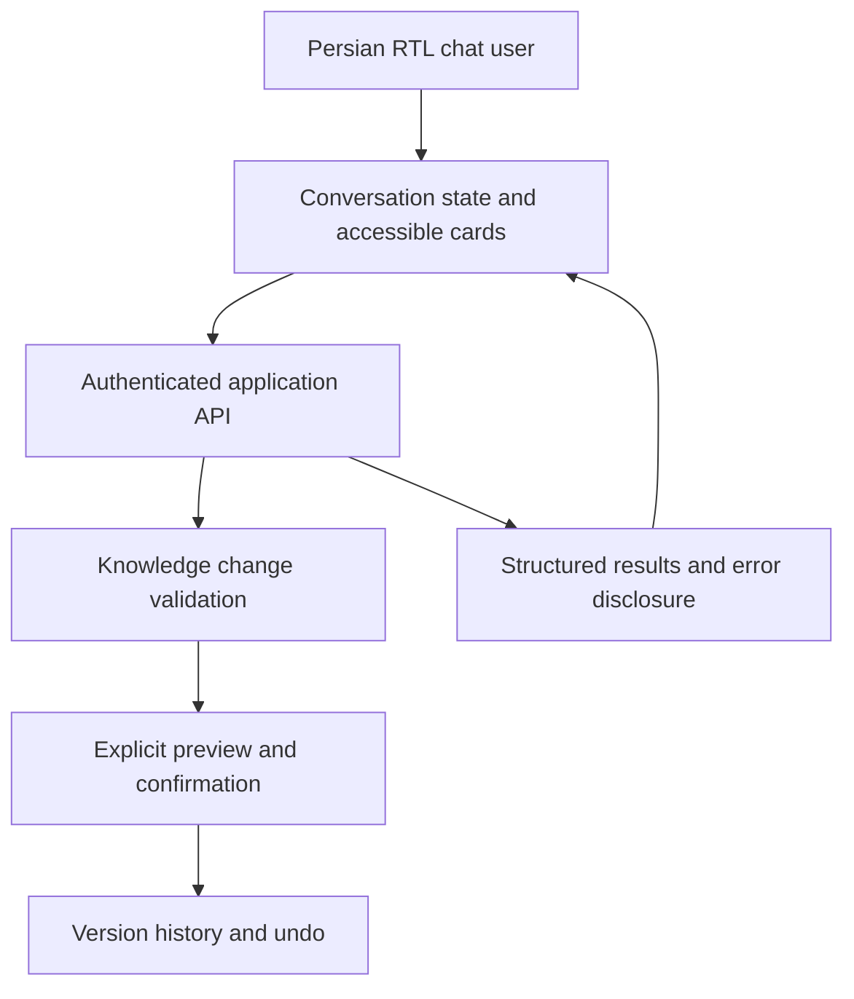

# Roniq AI — Persian-first Conversational Product UX — Public Technical Note

## Design question

How to make conversational actions predictable, comprehensible and reversible without treating untrusted generated text as committed state.

## Evidence and implementation boundary

The public repository describes an AI product interface and workflows. UI direction previously explored includes RTL conversations, structured answers, dashboard-style result cards and user-confirmed knowledge edits.

**Status: proposed/illustrative.** Each arrow is a logical contract to discuss, not an assertion about production processes, vendor deployment or shipped features. No live code or application environment is included in this repository.

## Reference component interactions

## Security, correctness and UX invariants

- Render assistant output as untrusted text; never execute arbitrary HTML or commands.
- A knowledge edit is not committed until the user sees a diff and explicitly approves it.
- Use revision IDs and optimistic concurrency to avoid undoing somebody else's changes.
- For RTL designs, keep numbers, currency and code direction explicit; check keyboard navigation and accessibility.

## Synthetic validation scenario

Example, not an implemented endpoint: a user asks to replace several knowledge records. UI previews affected IDs, fields and before/after values, requires confirmation, writes an audit revision, then offers undo tied to that revision.

## Trade-off / failure mode

Full-page chat UI must not hide the current entity, pending mutation or recovery path.

## Minimum evidence needed before marking implemented

1. Owner-approved implementation map or sanitised API contract.
2. Executable synthetic test data with expected outcomes and negative cases.
3. Dated test execution that distinguishes mocked or local tests from production.
4. No externally identifying data, credentials, addresses or actual tenant records.

See [README.md](README.md) for scope and [ROADMAP.md](ROADMAP.md) for planned public artifacts.
